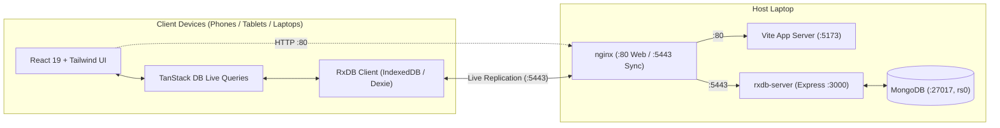

# Waves Architecture

Waves manages interval starts for orienteering meets across multiple phones, tablets, and laptops on a local Wi-Fi network without internet access.

---

## 1. System Overview

Waves uses a **local-first** architecture. Every connected browser keeps a complete copy of the meet database in IndexedDB (via RxDB + Dexie) so the UI responds instantly and continues working if Wi-Fi drops. A central sync server on the host laptop replicates changes between all connected devices and persists them to MongoDB.

### Core Components

| Component | Path | Purpose |
|---|---|---|
| **Web App** | `waves-app/` | React 19 + TypeScript + Tailwind 4 single-page app. |
| **Client Database** | `waves-app/src/database.ts` | RxDB (Dexie/IndexedDB) wrapped in TanStack DB collections for reactive UI queries. Uses pure-JS SHA-256 and UUID helpers (`cryptoHelpers.ts`) so it runs over plain HTTP on any LAN IP or domain. Automatically generates schema migrations and self-heals local IndexedDB cache on schema updates. |
| **Sync Server** | `waves-server/server.ts` | Express `rxdb-server` on port `3000` syncing `slots`, `participants`, and `changes` with MongoDB (`wavesmongodb_<eventId>`). Automatically rebuilds its RxDB cache from MongoDB if the schema changes. |
| **Reverse Proxy** | `waves-server/nginx.conf` | Listens on plain HTTP port `80` (web app) and port `5443` (RxDB replication stream) with `server_name _;`, allowing access via `localhost`, LAN IP, or local router DNS (`http://waves.cascadeoc.org`). |
| **Meet Scripts** | `make-start-list.cmd`, `start-waves.cmd`, `stop-waves.cmd` | Convert the meet Excel workbook (`data/input/*.xlsx` or `*.xlsm`) into `startlist.csv` + `event.json`, launch/stop all services, and automatically export per-meet CSV archives into `data/archive/<Meet Name>/` (`count_people_on_course.py`). |

---

## 2. Data Model

Each event uses an isolated database namespace keyed by `eventId` (from `waves-app/public/event.json`). There are three RxDB collections:

| Collection | Key Fields | Description |
|---|---|---|
| `slots` | `id`, `course`, `time`, `participants[]`, `isUsable` | Represents a `(course, time)` cell (`c1`–`c9`, `HH:MM`), plus two special holding slots per course: `_needsAssignment` (Standby) and `_notAttending`. New start times (e.g. `09:38`) can also be created during the meet. |
| `participants` | `id`, `name`, `club`, `epunch`, `isRental`, `isNonCompete`, `groupSize`, `state`, `prevState`, `originalStartTime`, `startChanged`, `needsWaiver`, `needsPayment`, `isSecondCourse`, `hasRentedCompass`, `compassId` | One starter or group entry. Every participant belongs to **exactly one** slot at all times. |
| `changes` | `id`, `participantId`, `changedAt`, `changeType`, `old`, `new`, `needsProcessing`, `isProcessed` | Append-only audit log of all edits (`epunch`, `newCourse`, `newTime`, `addedParticipant`, `competitiveStatus`, `groupSize`, `compassRental`, and attendance changes). |

### Participant States & Headcount Rules
- **`waiting`**: Scheduled in a start slot, not yet checked in.
- **`present`**: Checked in at **Call-up**.
- **`validated`**: E-punch verified at **E-punch Check**.
- **`wrongEpunch`** / **`noShow`**: Exception states (encoded in `state` and `prevState` so a runner can be flagged for both simultaneously and resolved independently).
- **`needsAssignment`**: In the **Standby** queue (`_needsAssignment` slot) awaiting an open start time.
- **`notAttending`**: Withdrawn from the meet (`_notAttending` slot); original start slot is freed.
- **Course Headcount**: Active entries count their `groupSize` plus `+1` adult shadow for original Non-Competitive (`NC`) starters. Second-course entries (`isSecondCourse: true`) never have a shadow (`+0` shadows even when marked `NC`).

---

## 3. Station Views & Post-Meet Archiving

- **View-Only Default & Volunteer PIN (`9465`)**: New browser sessions open on the read-only **Full Grid** so spectators, runners, and coaches can view live start times. Entering the 4-digit volunteer PIN (`9465`) unlocks all station tabs and editing controls (persisted in `localStorage`).
- **Call-up (`Callup.tsx`)**: Displays Current and Next waves (`+6` min ahead of clock time by default) to mark runners **Present** or **No Show**.
- **E-punch Check (`EpunchVerify.tsx`)**: Runs 2 minutes behind Call-up (`+4` min ahead of clock time by default) to mark runners **Validated** or **Wrong E-punch**, with inline e-punch editing right on the station card.
- **Start Manager (`Manager.tsx`)**: Exception handling—triage **Ineligible racers** (`N` shadow waiver / `Need $` → `Set as Eligible`), **Wrong e-punch**, **Standby** (with FIFO + conflict-aware priority notifications when a no-show opens a slot), and **No-shows**; reassign or create new start times (with **6-minute** same-school spacing recommendations); rent compasses with a **Compass ID**; and add walk-up or **2nd-course** runners.
- **Download (`Download.tsx`)**:
  - **Timing Computer Queue**: Collapses multi-hop edits for the same participant and category (`newCourse`, `epunch`, `competitiveStatus`) into a single net change (`first.old → last.new`) and omits zero-net-change round trips.
  - **Compass Box**: Right-hand panel with **`Needs Return`** and **`Returned`** tabs displaying each rented compass's `#<compassId>` badge next to the racer's name with one-click **Clear** / **Restore**.
- **Full Grid (`FullGrid.tsx`) & Change Log (`Changes.tsx`)**: Live meet overview (with course headcounts and runner action modal) and full chronological audit log.
- **Automatic Per-Meet Archive (`data/archive/<Meet Name>/`)**: Running `stop-waves.cmd` automatically exports `original_start_list.csv`, `change_log.csv`, `final_participant_status.csv`, `download_log.csv`, and `people_on_course.csv` into the meet's folder (rotating any previous export from the same meet into `history/<timestamp>/`).
