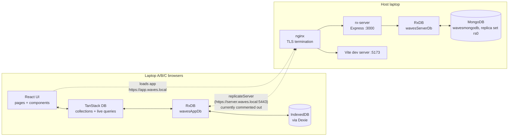
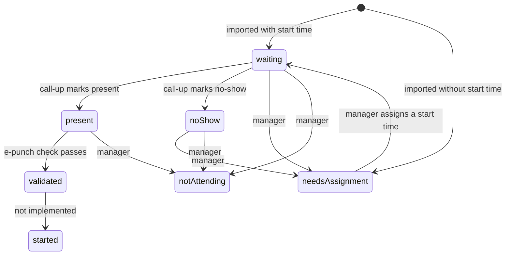

# Waves Architecture

Waves digitizes the start-management process of an orienteering interval-start event. Several volunteers, each on their own laptop, track participants as they move from "waiting" through call-up and e-punch verification to the start line, and the start manager handles exceptions (no-shows, late arrivals, reassignments).

> **About this document.** It was written from a code review of `waves-app/src`, `waves-server/server.ts`, `nginx.conf` and the git history. Items marked *(unverified)* are inferred and should be confirmed. The `waves-launcher/*.cmd` scripts had not been reviewed when this was written.

---

## 1. System overview

The system is **local-first**. Each browser holds a full copy of the data in IndexedDB and works offline. A server on the host laptop replicates changes between browsers.



### Components

| Component | Location | Role |
|---|---|---|
| **waves-app** | `waves-app/` | Vite + React 19 + Tailwind 4 single-page app. Starter template: "Vitamin". |
| **Browser database** | `src/database.ts`, `src/Schema.ts` | RxDB on Dexie/IndexedDB with three collections: `slots`, `participants`, `changes`. Each is wrapped in a TanStack DB collection so the UI can use `useLiveQuery`. |
| **waves-server** | `waves-server/server.ts` | Express-based `rxdb-server` that exposes a replication endpoint per collection. Its RxDB uses MongoDB storage and is kept in sync with the `wavesmongodb` database by `replicateMongoDB`. |
| **MongoDB** | host laptop | Durable store. Must run as a replica set (`rs0`) because change streams are required. |
| **nginx** | `waves-server/nginx.conf` | Terminates TLS and routes two hostnames (see §2). |
| **waves-launcher** | `waves-launcher/*.cmd` | Windows scripts that start mongo, rxserver, nginx and the app. `startdev.cmd` is the entry point *(unverified)*. |

---

## 2. Network and hostnames

| Hostname | Port | nginx forwards to | Purpose |
|---|---|---|---|
| `app.waves.local` | 443 | `https://127.0.0.1:5173` | The web app (Vite dev server) |
| `server.waves.local` | 5443 | `http://[::1]:3000` | rx-server replication API |

- Both names must resolve to the host laptop's IP on every client laptop (hosts file or router DNS).
- Everything is HTTPS. **This is required, not optional:** the app calls `crypto.randomUUID()`, which only exists in secure contexts. Over plain HTTP on a LAN address, every action would throw.
- Certificates live in `security/` and were signed by a locally generated root CA. Each client laptop's OS and browser must trust that root CA (Firefox has its own certificate store).
- CORS is handled in two places: nginx answers `OPTIONS` preflights for `https://app.waves.local`, and rx-server's `cors` option handles the actual responses.
- The app and server are on different origins (`app.waves.local` vs `server.waves.local:5443`), which is why CORS exists at all.

### nginx configuration notes

These are issues found in `nginx.conf` as committed:

1. **Hardcoded certificate paths** point at `C:/Users/eric/code/waves/security/...`. On any other machine nginx will refuse to start until they are changed.
2. **No WebSocket upgrade headers** on the `app.waves.local` block. The page loads, but Vite hot-reload won't work through nginx. Add `proxy_http_version 1.1; proxy_set_header Upgrade $http_upgrade; proxy_set_header Connection "upgrade";`.
3. **No `proxy_http_version 1.1`** on the `server.waves.local` block. nginx defaults to HTTP/1.0 toward upstreams, which can break the long-lived streaming connection RxDB uses to receive live changes. `proxy_buffering off` is already set. *(unverified; replication worked in earlier commits, so test before changing.)*
4. **IPv6 upstream.** nginx proxies to `[::1]:3000`, but `server.ts` listens on hostname `localhost`. Whether that binds IPv6, IPv4 or both depends on the Node version and OS. If replication fails with 502 errors, try `127.0.0.1` on both sides.
5. For event day, serve the output of `vite build` from nginx (`root` plus `try_files`) instead of proxying to the dev server.

---

## 3. Domain model

### Participants and slots

- A **participant** is one entry (a person, or a group counted by `groupSize`) with a `state`.
- A **slot** is the pair *(course, start time)*. Start times are plain strings such as `"10:02"`. Nothing in the system treats them as real times, but zero-padded `HH:MM` strings sort correctly.
- A slot holds an array of participant IDs. Usually it holds zero or one, but the model allows several.
- Each course also has two **magic slots**, created at import time:
  - `_notAttending`
  - `_needsAssignment`

  Participants who have no real start time live in these.
- A slot with `isUsable: false` is shown as "NOT Available".

### Invariants

1. Every participant is in **exactly one** slot, always.
2. States `waiting`, `present`, `validated` and `noShow` require a real start time, meaning a slot whose time does not begin with `_`.
3. `notAttending` requires the `_notAttending` slot. `needsAssignment` requires the `_needsAssignment` slot.

**None of these are enforced by the database.** They hold only because the functions in `actions/participantActions.ts` perform multi-step updates in the right order. A failure partway through a move can leave a participant in no slot (see §7).

### Collections

| Collection | Key fields | Notes |
|---|---|---|
| `slots` | `id`, `time`, `course`, `participants[]`, `isUsable` | Slot owns membership. |
| `participants` | `id`, `name`, `state`, `prevState`, `club`, `epunch`, `isRental`, `isNonCompete`, `groupSize`, `originalStartTime`, `startChanged` | `prevState` powers the "undo" on state buttons. `startChanged` and `originalStartTime` record that a participant was moved off their published time. |
| `changes` | `id`, `participantId`, `changedAt`, `changeType`, `old`, `new`, `needsProcessing`, `isProcessed` | Append-only audit log. |

`changeType` values currently written: `noShow`, `notAttending`, `needsAssignment`, `epunch`, `newTime`, `competitiveStatus`.

`needsProcessing` is set to `true` only for `epunch` and `competitiveStatus`. The intent is probably "someone must re-enter this in the timing software", but **no UI reads `needsProcessing` or `isProcessed` yet** *(confirm the intent)*.

### Participant state machine



In practice the action functions accept "(any?) → target", subject to the slot rules above, so the diagram shows the intended flow rather than every allowed edge.

- Clicking the button for the **current** state reverts to `prevState` (this is the miss-click undo). The change-log entry from the original action is not removed.
- `started` exists in the schema and type lists but nothing sets it, and the README does not list it.

---

## 4. Data flow: what happens when a button is tapped

Example: call-up taps **Present**.

1. `ParticipantStateChangeButton` calls `setStatePresent(participantId)`.
2. The action finds the participant's slot with `queryOnce`, checks that the slot has a real time, and updates the participant (`state`, `prevState`).
3. TanStack DB applies the change optimistically and RxDB writes it to IndexedDB.
4. Every mounted `useLiveQuery` re-runs and the UI re-renders.
5. With replication enabled, RxDB then pushes the change to the server, which writes to MongoDB. Other browsers receive it through their pull stream and update the same way.

`isPersisted.promise` resolves when the **local** write finishes, not when the server has the change.

### Moving a participant (the risky part)

`setStateNotAttending`, `setStateNeedsAssignment` and `setNewStartTime` each perform several separate writes:

1. Remove the participant ID from the old slot.
2. Add it to the new slot.
3. Update the participant's state and flags.
4. Insert a `changes` row.

These are independent transactions. They are not atomic, and other browsers can observe the intermediate states.

### Conflict handling

RxDB's default conflict handler is "master wins" per document. Two people editing the same document at nearly the same time will silently lose one edit. The dangerous case is slot membership arrays: two moves into the same magic slot at the same time can drop one participant. **Operational mitigation:** dedicate one laptop to the Manager page, since only the manager moves people between slots.

---

## 5. Frontend structure

```
waves-app/src
├── main.tsx                     entry; wraps App in QueryClient + BrowserRouter (router unused)
├── App.tsx                      error boundary + Suspense around the header
├── database.ts                  RxDB setup, replication wiring, TanStack collections, drop-all helpers
├── Schema.ts                    RxDB JSON schemas + TypeScript types
├── dataImport.ts                CSV import (one hardcoded start list)
├── actions/participantActions.ts  ALL state transitions and slot moves (business rules live here)
├── api/                         valibot types for hydrated Participant / Slot
├── components/
│   ├── HeaderWithWaveTime.tsx   real app shell: clock, wave offset, nav, page switch
│   ├── grid/                    StartGrid, GridSlot, ParticipantStateChangeButton
│   ├── Search*, Modal, Edit*    manager tools
│   └── WaveSelection, *OffsetEditor, Tags, icons, etc.
├── pages/
│   ├── Callup.tsx               current + next wave, buttons: present / noShow
│   ├── EpunchVerify.tsx         current + next wave, button: validated
│   ├── Manager.tsx              search, selected-participant actions, time + course grids
│   ├── FullGrid.tsx             whole event grid
│   └── Changes.tsx              chronological change log
└── utils/                       join helpers: populateSlotData, hydrateParticipant, hydrateChange, pivotSlotsToEntries, styleHelpers
```

### Key behaviours

- **Navigation** is a `useState` string in `HeaderWithWaveTime`, not react-router. This was deliberate (commit `0977cc0`, "remove routes so time doesn't reload"). Consequence: a refresh always returns to the Full Grid.
- **Live data**: every page calls `useLiveQuery` for whole collections and joins them in memory. Slots store participant IDs, and `populateSlotData` / `hydrateParticipant` turn them into objects for rendering.
- **Wave clock.** The header computes `now + clockOffset + waveOffset` (default offset +8 minutes) and looks for a matching start time. Call-up and e-punch pages default to the current wave plus the next one. Known weaknesses: the lookup breaks at hour rollover, with odd-minute starts, and with an offset of 0. The clock and wave offsets are per-device `useState`, so they reset on refresh and are not synced.
- **Roles** are just pages. There is no login and no per-role restriction.

| Role | Page | What they do |
|---|---|---|
| Call-up volunteer | Call-up | Mark participants present or no-show |
| E-punch check volunteer | Epunch Check | Mark participants validated |
| Start manager | Start Manager | Search, reassign times, not attending, needs new time, edit e-punch, competitive status |
| Anyone | Full Grid, Change Log | Read-only overview |

---

## 6. Importing event data

`dataImport.ts` loads `public/WIOL4UWStartListExpanded.csv` (a start list converted from a PDF) using hardcoded column names for nine courses (`c1`–`c9`).

1. Each row is one start time, with three columns per course (name, club/group, e-punch/flags).
2. For each cell it creates a participant and a slot. It also creates slots for empty cells.
3. It adds the two magic slots for each course.
4. It inserts participants, then slots.

The class-to-course mapping (`getCourseForClass`) belongs to the public-registration import, which is currently commented out. **A new event needs code changes** to import anything other than this one file.

The **`[temp] Load UW`** item in the nav menu deletes all slots, participants and changes, then re-imports. With replication on, that deletion propagates to every device.

---

## 7. Known issues and risks

**Sync and deployment**
- Replication is disabled in `database.ts` (`replicateRxCollectionsWithServer()` is commented out with a TODO). It worked in earlier commits (`a4cc0cb`, `e284677`) but has not been tested since Dexie storage and the `changes` collection were added.
- `server.ts` calls `createCollection` unconditionally, which may fail on the second start *(unverified)*.
- Server schema drift: `isUsable` is missing from the server's `slots` `required` list. Schemas are duplicated in `Schema.ts`, `server.ts` and the valibot files in `api/`.
- No authentication. Acceptable on an isolated event router only.
- No service worker, so reloading a laptop while the host is unreachable will not load the app.

**Data integrity**
- Multi-step moves are non-atomic (see §4). Failures produce participants in zero slots, surfaced as `alert("No Slot for Participant")` or a console log saying "BAD! Participant is not in any slot".
- `hydrateParticipant` returns `undefined` for participants in zero or multiple slots, so they vanish from the Manager page.
- `populateSlotData` silently drops slot entries whose participant is missing.
- Errors are mostly `alert()` calls or silent returns.

**Behaviour bugs**
- `ParticipantStateChangeButton` uses `onClick={action(toState)}`, which executes at render time. It should be `onClick={() => action(toState)?.()}`.
- `setStateNotAttending` does not record `originalStartTime`, so recovering from a mistaken "Not Attending" requires knowing the old time.
- Manager "Reset / Waiting" silently does nothing for participants in a magic slot. They must be reassigned via **Assign**.
- Page title for the change log is blank (`case 'change'` versus nav value `'changes'`).
- `Changes.tsx` and the state-button list lack React `key`s. `EpunchVerify` is titled "Tent 1: Call-up".
- The import path `@/pages/CallUp` does not match the file name `Callup.tsx` (works on Windows, fails on Linux/CI).
- Clock `useEffect` uses `setTimeout` with no cleanup.

**Unfinished features**
- Manager buttons showing "not yet implemented": Edit Name, Change Class/Course, Change Group.
- `started` state. `needsProcessing` / `isProcessed` workflow. Export. Flexible import.

**Tooling**
- Template leftovers: `mocks/`, MSW, `App.test.tsx`, `tests/app.spec.ts`, `test-utils.tsx`. They test a fruit list and will fail.
- `vite.config.ts` enforces 100% coverage with `bail: 1`, so `pnpm test:ci` cannot pass.
- Two lockfiles in `waves-app` (`package-lock.json` and `pnpm-lock.yaml`). The README says pnpm.
- `security/waves-key.pem` is committed. `vite.config.ts` reads certs via a path relative to `waves-app/`.

---

## 8. Running the system

Startup order, per the README (the launcher scripts automate this):

1. **MongoDB** as replica set `rs0` (`mongod --replSet rs0 ...`). Run `rs.initiate(...)` once in `mongosh` if the prompt does not start with `rs0`.
2. **waves-server**: `npx ts-node server.ts` in `waves-server/`. It is ready when it prints `started rx-server`.
3. **nginx** with paths fixed for your machine.
4. **waves-app**: `pnpm dev` in `waves-app/`.
5. Make `app.waves.local` and `server.waves.local` resolve to the host IP, and trust the root CA on each laptop.
6. Open `https://app.waves.local`.

**Resetting data or changing schemas** (no migrations exist): stop app and server, delete `wavesServerDb-v0` and `wavesmongodb` in MongoDB Compass, clear IndexedDB in every browser, then restart and reload. Update the schema in both `Schema.ts` and `server.ts`.

**Useful inspection points:** DevTools → Application → IndexedDB shows each browser's copy. MongoDB Compass shows the server's copy. Watch both while tapping a button.

---

## 9. Roadmap

**Phase 1: prove the baseline**
- Fix nginx paths and headers. Re-enable replication and test with two browsers, then three laptops on the event router.
- Test server stop/start, and offline edits followed by reconnect.

**Phase 2: must-fix before real use**
- Fix the state-button `onClick` bug, `originalStartTime` on Not Attending, and silent failures in Reset/Waiting.
- Remove or guard `[temp] Load UW`.
- Add backups: a Mongo dump script and a JSON/CSV export of participants and changes.
- Add an integrity page listing participants in zero or multiple slots, with a repair action.
- Persist clock and wave offsets. Fix the wave-lookup edge cases.
- Serve a production build from nginx.

**Phase 3: rehearsal**
- Full dry run with three laptops, the real CSV, the router, and deliberate operator mistakes.

**Phase 4: hardening and features**
- Add `slotId` to participants so "exactly one slot" holds by construction, with slot membership derived.
- Custom conflict handler. Single schema source of truth (derive valibot types from `Schema.ts`).
- Finish the Manager buttons. Decide what `started` means. Build a proper import/export flow.
- Real routes, real tests, a service worker.

---

## 10. Glossary

- **Wave**: a start time shared by all courses (for example `10:02`).
- **Slot**: one course at one start time. May be empty ("available") or unusable.
- **Magic slot**: `_notAttending` or `_needsAssignment`, one of each per course.
- **Call-up**: the tent where participants check in before their start.
- **E-punch (SportIdent) check**: confirming the electronic punch number on record matches the one the participant holds.
- **Wave offset**: how many minutes ahead of the clock the call-up wave runs (default 8).
- **Clock offset**: correction applied to the device clock.
